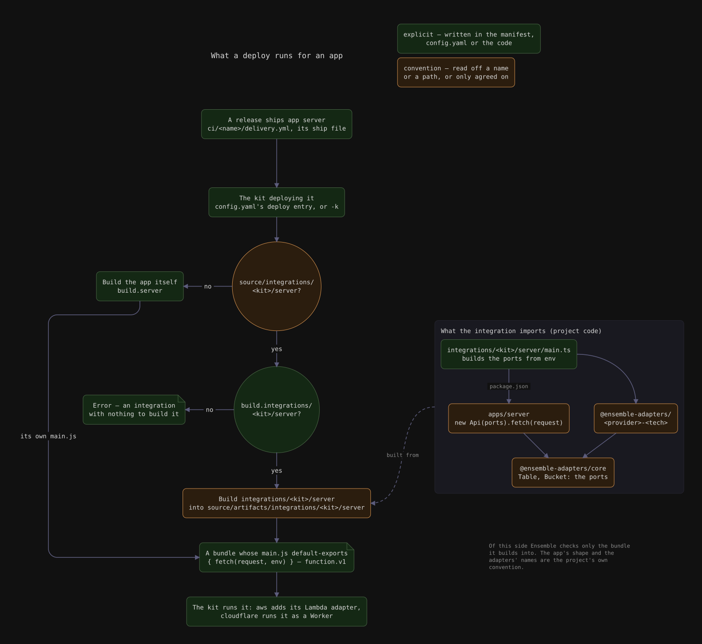

# Workspace layout

Ensemble's core idea is that a project's folder structure should tell you where
to find something without you needing to remember a convention. Every concern —
app source, packaging, build output, shared code, deployment — gets its own
top-level home, and nothing crosses those lines implicitly.

```
source/
  apps/<name>/       # app source, one folder per deployable unit
  core/               # shared code that speaks your project's domain
  libs/               # generic, cross-project-reusable code
  integrations/<kit>/<app>/  # an app wired for one deploy kit's platform (optional)
  artifacts/<name>/   # build output (gitignored), one folder per app
  ship/<name>/        # packaging inputs (Dockerfile, etc.) per pack target
.ensemble/
  kits/build/<kit>/   # build kit implementations
  kits/pack/<kit>/    # pack kit implementations
  kits/deploy/<kit>/  # deploy kit implementations
  config.yaml         # shared, git-tracked: app -> build kit, workload -> deploy kit
  config.local.yaml   # gitignored, per-developer: personal var defaults
ci/<name>/
  delivery.yml         # the workload's delivery manifest (release + deploy)
```

`apps/<name>` and `ship/<name>` both support nesting — a multi-process app made
of several independently built/packed units lives as `apps/my_app/server` and
`apps/my_app/client` (mirrored under `ship/my_app/server`, `ship/my_app/client`
if both get packed). `<name>` throughout the CLI (`ens build <app>`,
`ens config set-build-kit <app> <kit>`, ...) means that full path relative to
`apps/`, not just the top-level folder.

## The principles behind the layout

- **Each app is self-contained.** Everything an app needs to build lives under
  its own `source/apps/<name>`. Every app is potentially a separate deployable
  artifact, so it should build and run independently of the others.

- **Concerns live in their own top-level folder.** Source (`source/apps`),
  packaging (`source/ship`), and build output (`source/artifacts`) are kept
  apart, so you can focus on the layer you're changing without wading through
  the others.

- **Shared code is explicit and intentional.** Cross-cutting logic lives in
  `source/core` and `source/libs`, pulled in deliberately instead of apps
  reaching into each other's folders. `core` speaks your project's own domain;
  `libs` is generic enough to be reused across projects — see
  [Managing libraries](../guides/managing-libraries.md) for how a lib gets
  shared out.

- **Kits carry the mess so app folders don't have to.** Build, pack, and deploy
  logic lives in `.ensemble/kits`, behind a common contract. An app folder only
  ever states _which_ kit it uses, never _how_ that kit builds, packages, or
  deploys it. See [Kits](kits.md).

## Integrations



An app can stay free of every platform: its code takes the resources it needs as
ports — a table, a bucket — and leaves where they come from to an
**integration**, `source/integrations/<kit>/<app>`. An integration is the app's
wiring for the platform one deploy kit deploys to: it builds the ports from that
platform's resources (DynamoDB on `aws`, D1 on `cloudflare`), owns the
dependencies that takes, and exports what the kit runs — for a `function`, a
`main.js` default-exporting `{ fetch(request, env) }`, with `env` as the kit
documents it.

An integration is built like an app, under the name `integrations/<kit>/<app>`
(`build.integrations/<kit>/<app>` in `config.yaml`, output at
`source/artifacts/integrations/<kit>/<app>`). Wherever the manifest names the
app — a release's ship, a `development.sync` rule — the kit deploying runs that
app's integration for it, so one delivery manifest deploys to every platform an
app is wired for, and a release carries one bundle per integration. Integrations
are optional: an app with none is its own bundle, whichever kit deploys it — the
quickest way to start on one platform, before wiring a second.
`ens app create <build kit> <app> --integration <deploy kit>` scaffolds one for
an existing app and registers its build entry. An integration's folder with no
build entry is an error rather than a reason to run the app instead, and the
`integrations/` prefix is reserved: no app is named under it.

Nothing here is an Ensemble API: the kit and the integration meet on a module
shape and a documented `env`, and the ports are the project's own.

## `.ensemble/config.yaml` vs `.ensemble/config.local.yaml`

Two files hold configuration, split by what should be shared with the team
versus what's a personal convenience:

- **`config.yaml`** — shared, git-tracked. Which build kit each app uses
  (`ens config set-build-kit`), and which deploy kit a workload deploys with
  when the command names none (`deploy.<name>.kit`, for a workload only one kit
  can deploy).
- **`config.local.yaml`** — gitignored, per-developer. Default build/pack vars
  you don't want to type on every invocation (`ens config
  set-build-var`,
  `ens config set-pack-var`).

## Next

- [Kits](kits.md) — what a kit is and the three roles it can play.
- [Delivery manifests](delivery-manifests.md) — how a workload is declared and
  brought up.
