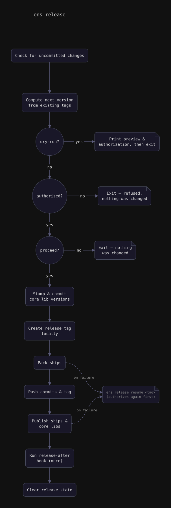

# `ens release`

Create, resume, or undo a semver release tag — plus the ceremony that goes with
it: packing and publishing every ship a workload's `release:` section declares,
and every core library declared for publishing, then running any configured
`hooks.release.after` (e.g. a changelog update) and pushing what they produce.

Global flags, available on every subcommand:

- `--dry-run` — preview without making changes.
- `-p, --pre-release <suffix>` — append a `-<suffix>` identifier. Ignored by
  `undo` and `resume`.
- `-m, --meta <suffix>` — append a `+<suffix>` build metadata identifier.
  Ignored by `undo` and `resume`.
- `-r, --remote <name>` — remote to push to/delete from when confirmed. Default:
  `origin`.
- `-y, --yes` — answer yes to every confirmation prompt (uncommitted changes,
  the ceremony's "Proceed?", `undo`'s remote delete), for unattended runs such
  as CI or an agent. Each question is still printed, followed by `yes (--yes)`.

## Publish authorization

Anyone can run a release; what decides who actually _can_ is write access to the
places it publishes to. So before a release changes anything — before the
confirmation prompt, the core-library version stamp, the commit, or the tag —
every publish still left to do is checked from the current machine:

- each ship's pack kit runs its `authorize.ts` (same arguments and
  `.ensemble/release/secrets.env` credentials as its `publish.ts`);
- each core library's lib kit runs its `authorize` step.

If any check refuses, the release stops, names every refused publish with the
kit's reason, and exits non-zero with nothing changed. A pack kit without an
`authorize.ts` counts as a refusal, since it can't vouch for the publish.
`--dry-run` runs the same checks and reports whether the release would be
refused. The standalone `ens publish` and `ens lib publish` commands run the
same check for their single publish, before publishing or stamping anything.

What the bundled kits check:

| Kit            | Target        | Check                                                                                                         |
| -------------- | ------------- | ------------------------------------------------------------------------------------------------------------- |
| `deno.compile` | `github`      | `gh`'s account has write (or maintain/admin) access to the repository.                                        |
| `vscode`       | `marketplace` | `VSCE_PAT` has publish rights for the manifest's `publisher` (`vsce verify-pat`).                             |
| `docker`       | `push`        | docker's own credentials can open a blob upload on the target repository (cancelled straight away).           |
| `jsr` (lib)    | —             | `JSR_TOKEN` is set and its account is a member of the package's scope. Interactive browser auth isn't enough. |

`JSR_TOKEN` must have full API access: JSR won't let a publish-only token read
its own account's scope memberships, so the check can't vouch for one and
refuses it.

## `ens release next <patch|minor|major>`

Bump the version from the last tag and create a new release.

```sh
ens release next patch --dry-run
ens release next minor -p rc.1     # v1.3.0-rc.1
```

A non-dry-run goes through these steps, in order:

1. If you have uncommitted changes, you're asked to confirm (the tag won't
   reflect them).
2. Every publish is checked from this machine (see
   [Publish authorization](#publish-authorization)). A refusal stops here, with
   nothing changed.
3. It lists what it will pack and publish and asks you to confirm once.
   Declining stops here, with nothing changed.
4. Core-library versions are stamped and committed, and the tag is created
   locally.
5. Ships are packed, commits and tag are pushed, then ships and core libraries
   are published, without asking again.
6. `hooks.release.after` runs (once per tag) and whatever it commits is pushed.

A failure during packing or publishing leaves an accurate record of what's left
(`.ensemble/release/state/<tag>.json`) for `resume` to pick up.



## `ens release set <version>`

Set an arbitrary version (shape `x.y.z`) and create a new release. Same ceremony
and confirmation behavior as `next`.

```sh
ens release set 2.0.0 -r upstream
```

## `ens release resume <tag>`

Re-run the ceremony for a tag that's already been created — for finishing a
release after a partial failure. Picks up exactly where it left off and never
re-runs `hooks.release.after` once it's already run for this tag. The publishes
still left to do are authorized again first, so a resume from a machine without
write access is refused before it packs or pushes anything.

```sh
ens release resume v1.4.2
ens release resume v1.4.2 --only web,my-lib
ens release resume v1.4.2 --skip my-lib
```

- `--only <names>` — comma-separated ship/library names to include (default:
  everything still left to do).
- `--skip <names>` — comma-separated ship/library names to exclude.

## `ens release undo`

Delete the last tag locally. Does not touch any commit.

```sh
ens release undo
ens release undo --dry-run
```

Prompts to also delete the tag from the remote once it's deleted locally.
