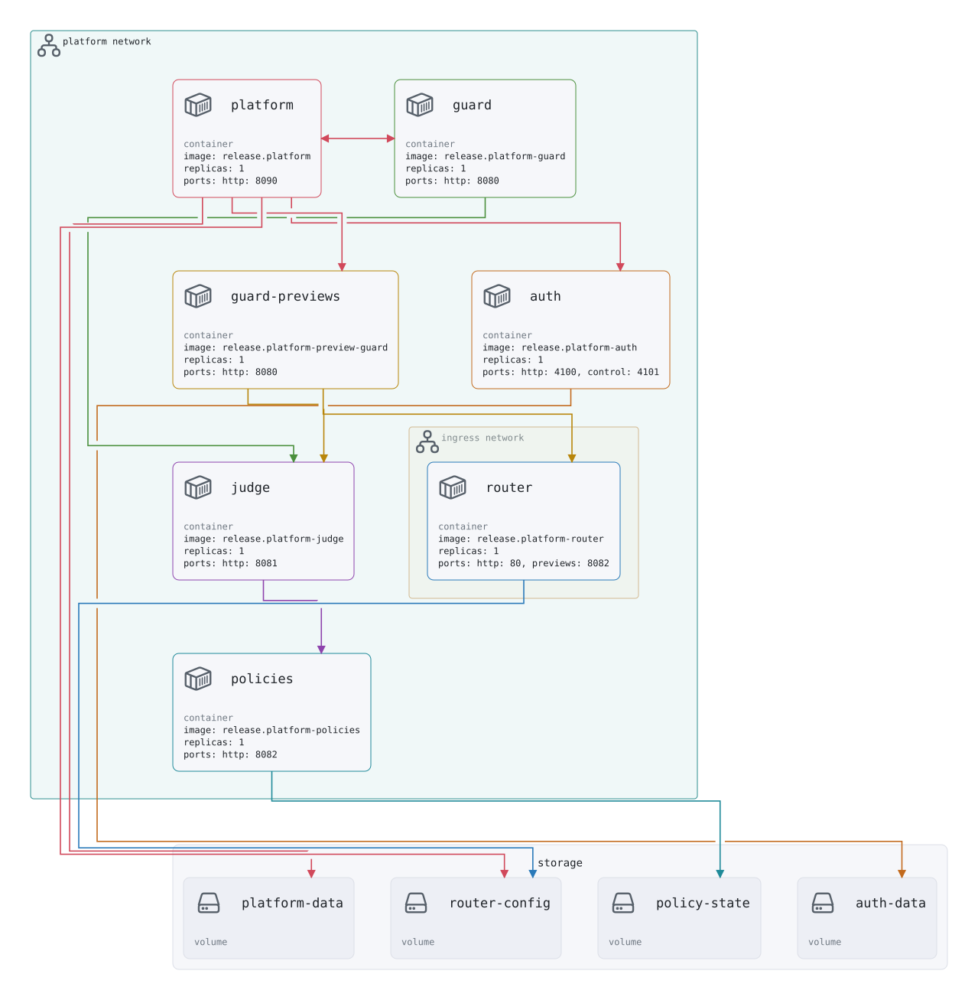

# platform architecture

<picture><source media="(prefers-color-scheme: dark)" srcset="architecture.svg"></picture>

Drawn from `ci/platform/delivery.yml` by `ens delivery print platform --render markdown`; the drawing's source is [architecture.reladraw](architecture.reladraw). A network is an area around the computes attached to it (a compute on two networks sits where they overlap). An arrow goes from what uses to what it uses, and has the color of the compute it leaves. Variables and secrets are not drawn, so the tables below list them and every use of them.

## compute

| Name | Type | Details | Uses | Used by |
| --- | --- | --- | --- | --- |
| `platform` | container | image: release.platform replicas: 1 ports: http: 8090 | `variables.registry_credentials` `storage.router-config` `storage.platform-data` `secrets.platform-secret-key` `variables.stack` `release.platform` `compute.guard-previews` `variables.platform_host` `compute.guard` `variables.auth_host` `compute.auth` `variables.preview_domain` `external.platform` | `compute.guard` |
| `router` | container | image: release.platform-router replicas: 1 ports: http: 80, previews: 8082 | `storage.router-config` `external.platform` `external.ingress` `release.platform-router` | `compute.guard-previews` |
| `guard` | container | image: release.platform-guard replicas: 1 ports: http: 8080 | `compute.platform` `compute.judge` `external.platform` `release.platform-guard` | `compute.platform` |
| `guard-previews` | container | image: release.platform-preview-guard replicas: 1 ports: http: 8080 | `compute.router` `compute.judge` `external.platform` `release.platform-preview-guard` | `compute.platform` |
| `judge` | container | image: release.platform-judge replicas: 1 ports: http: 8081 | `compute.policies` `external.platform` `release.platform-judge` | `compute.guard` `compute.guard-previews` |
| `policies` | container | image: release.platform-policies replicas: 1 ports: http: 8082 | `storage.policy-state` `external.platform` `release.platform-policies` | `compute.judge` |
| `auth` | container | image: release.platform-auth replicas: 1 ports: http: 4100, control: 4101 | `storage.auth-data` `secrets.auth-secret` `variables.admin_email` `variables.preview_domain` `variables.platform_host` `variables.auth_host` `external.platform` `release.platform-auth` | `compute.platform` |

## storage

| Name | Type | Details | Used by |
| --- | --- | --- | --- |
| `platform-data` | volume |  | `compute.platform` |
| `router-config` | volume |  | `compute.platform` `compute.router` |
| `policy-state` | volume |  | `compute.policies` |
| `auth-data` | volume |  | `compute.auth` |

## secrets

| Name | Type | Details | Used by |
| --- | --- | --- | --- |
| `platform-secret-key` | environment | Key the platform seals its stored secrets with; keep it, as secrets sealed with one key open with no other (PLATFORM_SECRET_KEY) | `compute.platform` |
| `auth-secret` | environment | Secret khatm signs sessions with (AUTH_SECRET) | `compute.auth` |

## variables

| Name | Type | Details | Used by |
| --- | --- | --- | --- |
| `stack` | string | Compose project name, which the containers are named after and the platform knows itself by default: ensemble-platform | `compute.platform` |
| `platform_host` | string | Host the platform's UI and its GitHub App webhook answer on default: platform.ensemble.blue | `compute.platform` `compute.auth` |
| `auth_host` | string | Host khatm's sign-in answers on default: auth.ensemble.blue | `compute.platform` `compute.auth` |
| `preview_domain` | string | Domain previews answer one label beneath and the sign-in cookie is set on, so it must hold the platform and auth hosts too default: ensemble.blue | `compute.platform` `compute.auth` |
| `admin_email` | string | Email of the first operator, created on khatm's first start default: operator@ensemble.blue | `compute.auth` |
| `registry_credentials` | string | Host directory with the registry logins deploys pull and release packs push with; Docker creates it empty if missing, so no logins until one is made default: /var/lib/ens-platform/docker | `compute.platform` |

## external

| Name | Type | Details | Used by |
| --- | --- | --- | --- |
| `ingress` | network | name: ingress | `compute.router` |
| `platform` | network | name: platform | `compute.platform` `compute.router` `compute.guard` `compute.guard-previews` `compute.judge` `compute.policies` `compute.auth` |
