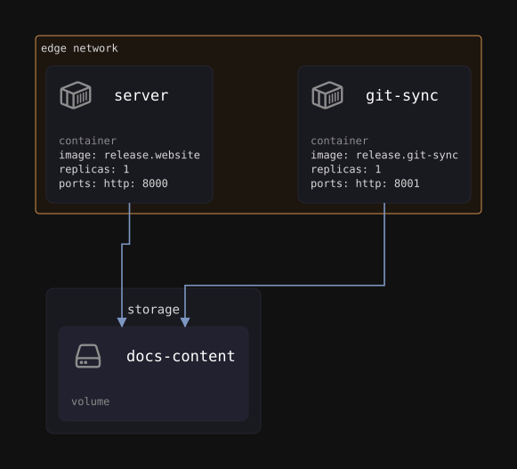

# website architecture

Drawn from `ci/website/delivery.yml` by `ens delivery print website --render markdown`; the drawing's source is [architecture.reladraw](architecture.reladraw). A network is an area around the computes attached to it (a compute on two networks sits where they overlap). An arrow goes from what uses to what it uses, and is colored by what it points at. Variables and secrets are not drawn, so the tables below list them and every use of them.

## compute

| Name | Type | Details | Uses |
| --- | --- | --- | --- |
| `server` | container | image: release.website replicas: 1 ports: http: 8000 | `storage.docs-content` `external.edge` `release.website` |
| `git-sync` | container | image: release.git-sync replicas: 1 ports: http: 8001 | `storage.docs-content` `secrets.docs-webhook-secret` `variables.repos` `external.edge` `release.git-sync` |

## storage

| Name | Type | Details | Used by |
| --- | --- | --- | --- |
| `docs-content` | volume |  | `compute.server` `compute.git-sync` |

## secrets

| Name | Type | Details | Used by |
| --- | --- | --- | --- |
| `docs-webhook-secret` | environment | Secret the docs repository's GitHub webhook signs its deliveries with (WEBHOOK_SECRET_DOCS) | `compute.git-sync` |

## variables

| Name | Type | Details | Used by |
| --- | --- | --- | --- |
| `repos` | string | JSON list of the repositories, refs and paths the website builds its content from default: [{"id":"docs","repo":"ritajhq/ensemble","ref":"main","path":"docs"},{"id":"docs","repo":"ritajhq/ensemble","ref":"main","path":"docs", "trigger":"manual"}] | `compute.git-sync` |

## external

| Name | Type | Details | Used by |
| --- | --- | --- | --- |
| `edge` | network | name: edge | `compute.server` `compute.git-sync` |
