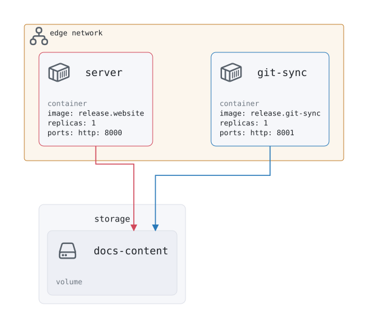

# website architecture

<picture><source media="(prefers-color-scheme: dark)" srcset="architecture.svg"></picture>

## Variables and secrets

| Name | Type | Details | Used by |
| --- | --- | --- | --- |
| `docs-webhook-secret` | secret: environment | Secret the docs repository's GitHub webhook signs its deliveries with (WEBHOOK_SECRET_DOCS) | `compute.git-sync` |
| `repos` | variable: string | JSON list of the repositories, refs and paths the website builds its content from default: [{"id":"docs","repo":"ritajhq/ensemble","ref":"main","path":"docs"},{"id":"docs","repo":"ritajhq/ensemble","ref":"main","path":"docs", "trigger":"manual"}] | `compute.git-sync` |

## External

The deployment relies on what it doesn't create: `edge` (network, name: edge).
