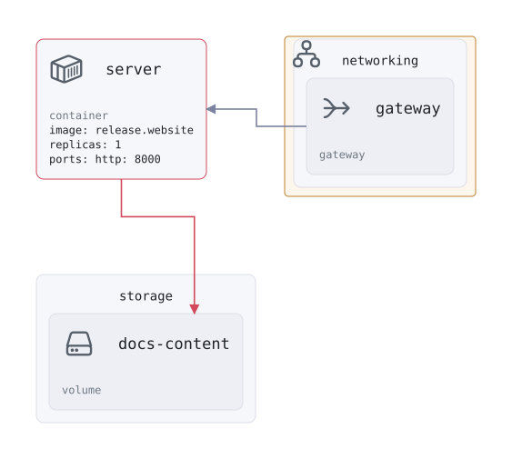

# website architecture

<picture><source media="(prefers-color-scheme: dark)" srcset="architecture.svg"></picture>

## Variables and secrets

| Name | Type | Details | Used by |
| --- | --- | --- | --- |
| `domain` | variable: string | Host the website answers on default: docs.ensemble.lvh.me | `networking.gateway` |
| `docs-repository` | variable: string | GitHub repository (owner/name) the docs are published from default: ritajhq/ensemble | `compute.server` |
| `docs-ref` | variable: string | Branch or tag of that repository the docs follow default: main | `compute.server` |
| `docs-poll-seconds` | variable: string | Seconds between checks of the repository for new commits default: 300 | `compute.server` |

## External

The deployment relies on what it doesn't create: `edge` (network, name: edge).
